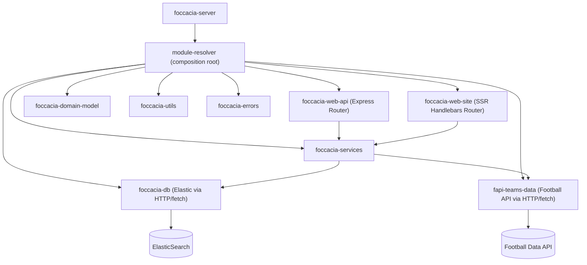

# IPW - Introdução à Programação Web

## Assignment 3
___

- [Practical Assignment](https://github.com/isel-leic-ipw/2526i-IPW-LEIC31D/wiki/IPW_IP-2526-1-A3)


<p align="center">
  
</p>

<h2 align="center">📅 Due date for this assignment: 19/12/2025 — 23h59</h2>

---

## Foccacia

Projeto multi-modulos em Node.js (ESM) - documentação curta para instalação, testes e cobertura.

### Estrutura verificada
Modulos presentes:
- `foccacia-server`
- `foccacia-web-api`
- `foccacia-services`
- `fapi-teams-data`
- `foccacia-data-mem`
- `foccacia-utils`
- `TODO : other modules`

Cada módulo tem `package.json`, `src/` e `test/` com testes ESM (`*.test.mjs`).

### Requisitos
- Node.js >= 18
- npm >= 9
- Ambiente: WSL/Ubuntu recomendado para scripts fornecidos

### Configuração recomendada (root `package.json`)
Adicionar workspaces para gestão centralizada:
```json
{
"workspaces": [
"foccacia-server",
"foccacia-web-api",
"foccacia-services",
"fapi-teams-data",
"foccacia-data-mem",
"foccacia-utils",
"TODO : other-modules"
]
}
```

### Instalação
```sh

npm install
```

## Testes
- Comando para executar todos os testes:
```sh

npm run test:all
``` 

## Coverage
- Comando para gerar coverage de todos:
```sh

npm run coverage:all
 ```

___

## Simple Guide to Using GitHub Version Control
___

### **In the Console**

1. **Clone the repository:**
   ```sh
   git clone <repository_link>
   ```

2. **Fetch the latest changes:**
   ```sh
   git fetch
   ```

3. **Before rebasing, remove and save your changes:**
   ```sh
   git stash
   ```

4. **Rebase on the main branch:**
   ```sh
   git rebase origin/main
   ```

5. **After rebasing, retrieve your saved changes:**
   ```sh
   git stash pop
   ```

6. **Create and switch to a new branch:**
   ```sh
   git checkout -b "branch-name"
   ```

7. **Add changes locally:**
   ```sh
   git add <file_path>
   ```

8. **Commit changes locally:**
   ```sh
   git commit -m "message about the changes"
   ```

9. **Push changes to the remote repository:**
   ```sh
   git push
   ```

### **On the Remote Repository (GitHub)**

1. **Go to GitHub and navigate to your repository.**
2. **Switch to your branch.**
3. **Open a Pull Request (PR) and request a review.**

___

## Dependências entre módulos com Dependency Injection



# TODO (standby)

## Login/Auth (fase seguinte)
- [ ] Substituir login global do SSR por Passport (e sessão/cookies) para suportar múltiplos utilizadores.

## data-mem (standby)
- [ ] Alinhar assinaturas e retornos com o contrato do data-elastic (object args).
- [ ] deleteGroup -> boolean
- [ ] addPlayerToGroup -> Player
- [ ] deletePlayerFromGroup -> boolean

## OpenAPI (standby)
- [ ] Alinhar schemas e respostas com a implementação atual (summary vs detail, playerId vs id, deletes 204 vs 200).

## Testes (standby)
- [ ] Unit tests do services com mocks (data + fapiTeams).
- [ ] (Opcional) supertest para integração.


## Divisão de tarefas

### Perfis

- **Dev Dinis Correia – Erros e robustez**  
  Foco em error handling, códigos HTTP, mensagens claras.

- **Dev Francisco Mendes – Refactor e modularização**  
  Foco em simplificar funções, extrair helpers, bons nomes.

- **Dev Tiago Nevoa – Arquitetura**  
  Foco em organização de módulos, dependências e alinhamento com o enunciado.

---

### Fase 1 – Arquitetura e dependências (Tiago Névoa)

---

### Fase 2 – Erros e autenticação (Dinis Correia)

---

### Fase 3 – Refactor e regras de negócio (Francisco Mendes)

---

### Fase 4 – Integração final e documentação

1. Dev Tiago Névoa:
    - 
    - 
2. Dev Dinis Correia:
    - 
    - 
3. Dev Francisco Mendes:
    - 
    -
