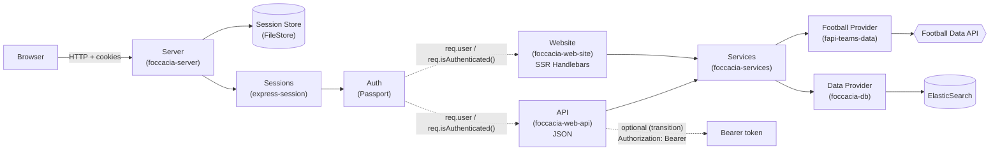
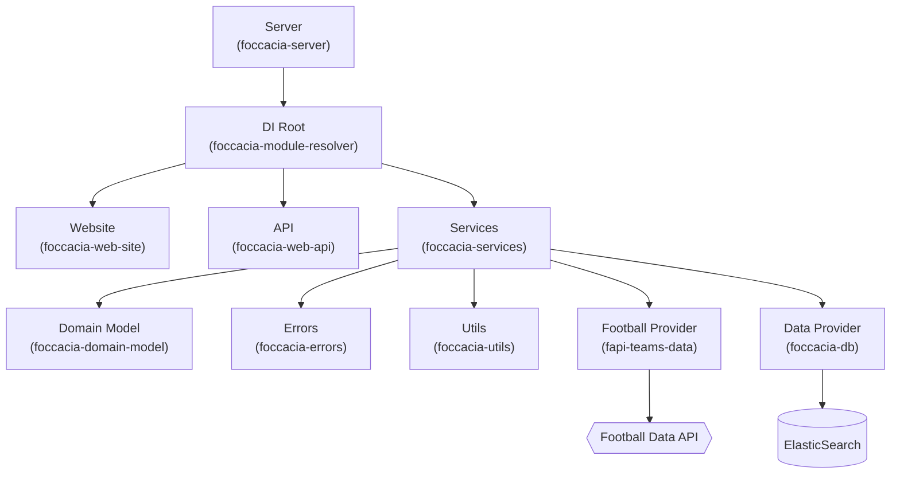

# IPW - Introdução à Programação Web

## Assignment 4
___

- [Practical Assignment](https://github.com/isel-leic-ipw/2526i-IPW-LEIC31D/wiki/IPW_IP-2526-1-A4)


<p align="center">
  
</p>

<h2 align="center">📅 Due date for this assignment: 11/01/2026 — 23h59</h2>

---

## Foccacia

Projeto multi-modulos em Node.js - documentação curta para instalação, testes e cobertura.

### Estrutura verificada
- `foccacia-server` (Express entrypoint + configuração)
- `foccacia-module-resolver` (composition root / DI)
- `foccacia-web-api` (API JSON)
- `foccacia-web-site` (Handlebars + forms)
- `foccacia-services` (lógica + validações)
- `foccacia-domain-model` (entidades internas)
- `fapi-teams-data` (Football Data API via fetch + cache)
- `foccacia-db` (ElasticSearch via HTTP fetch)
- `foccacia-data-mem` (standby / compatibilidade)
- `foccacia-errors` (erros tipados)
- `foccacia-utils` (helpers / logging / IO)

### Requisitos
- Node.js >= 18
- npm >= 9
- Docker (para ElasticSearch)
- Ambiente: WSL/Ubuntu recomendado para scripts fornecidos

---

## Configuração

### 1) Football Data API token
Criar o ficheiro:
- `docs/input/headers.json`

Com o conteúdo:
```json
{
  "X-Auth-Token": "COLOCA_AQUI_O_TEU_TOKEN"
}
```

### 2) ElasticSearch (Docker)
Run:
```sh
npm run docker:up
```

Stop:
```sh
npm run docker:down
```

Limpar volumes:
```sh
npm run docker:down:clean
```

---

## Instalação
```sh
npm install
```

---

## Executar
```sh
npm start
```

- Website: `http://localhost:1904/`
- API: `http://localhost:1904/api/`
- ElasticSearch: `http://localhost:9200/`

---

## Testes
Executar todos:
```sh
npm run test:all
```

---

## Coverage
Gerar coverage de todos:
```sh
npm run coverage:all
```

---

## GitHub Version Control
___

### **In the Console**

1. **Clone the repository:**
   ```sh
   git clone <repository_link>
   ```

2. **Fetch the latest changes:**
   ```sh
   git fetch
   ```

3. **Before rebasing, remove and save your changes:**
   ```sh
   git stash
   ```

4. **Rebase on the main branch:**
   ```sh
   git rebase origin/main
   ```

5. **After rebasing, retrieve your saved changes:**
   ```sh
   git stash pop
   ```

6. **Create and switch to a new branch:**
   ```sh
   git checkout -b "branch-name"
   ```

7. **Add changes locally:**
   ```sh
   git add <file_path>
   ```

8. **Commit changes locally:**
   ```sh
   git commit -m "message about the changes"
   ```

9. **Push changes to the remote repository:**
   ```sh
   git push
   ```

### **On the Remote Repository (GitHub)**

1. **Go to GitHub and navigate to your repository.**
2. **Switch to your branch.**
3. **Open a Pull Request (PR) and request a review.**

___

## Arquitetura

1. Request flow



2. Dependency wiring (DI)



---

# TODO

## Documentacao:
- [ ] Atualizar OpenAPI: `groupId` como string + exemplos de erros (401/403/422/429)
- [ ] Documentar no OpenAPI que a API aceita Bearer e/ou sessao (cookie) durante transicao

## Runbook e dados:
- [ ] Explicitar reset total:
    - `npm run docker:down:clean` (apaga ES)
    - apagar `sessions/` (logout total)
    - opcional: apagar `docs/output/football-api-cache/` (refaz cache)
- [ ] (opcional) seed de demo: 2 users + 1 grupo + 1-2 players

## Qualidade:
- [ ] Unit tests nos services com mocks (data, fapiTeams) 
- [ ] (opcional) testes de integracao com supertest 

---

## Wiki/Relatório

Sugestao de estrutura (curta, alinhada com o enunciado):

1) Visao geral
    - API JSON + Website SSR
    - Node ESM, Express, Handlebars, Passport, ElasticSearch

2) Estrutura da aplicacao
    - 1-2 linhas por modulo (secao "Estrutura do projeto")
    - diagramas Mermaid (secao "Arquitetura")

3) Armazenamento (ElasticSearch)
    - indices: `foccacia-users`, `foccacia-groups`
    - propriedades dos documentos (exemplos JSON)
    - relacao: `group.ownerId -> userId`

4) Mapping ES <-> Domain model
    - `User` e `Group` mapeados 1:1 (campos principais)
    - `players` guardados como snapshot (nao normalizado)

5) Autenticacao e autorizacao
    - SSR: sessoes (Passport + express-session + FileStore)
    - API: sessao ou Bearer token (transicao)
    - owner-only: enforced nos services em todas as operacoes

6) API documentation
    - OpenAPI + `.http`

7) Como executar e testar
    - runbook < 5 min
    - smoke tests SSR + sequencia `.http`


### Autenticacao

#### SSR (Passport + sessao)

Rotas:
- `GET /register` + `POST /register`
- `GET /login` + `POST /login`
- `POST /logout`
- Tudo em `/groups` exige autenticacao (redirect para `/login`)

A sessao e guardada em ficheiros (session-file-store) na pasta `sessions/`.

#### API (sessao ou Bearer token)

As rotas privadas em `/api/groups` aceitam:
1) Cookie de sessao (se fizeres login no Website e depois chamares `/api/` no browser), ou
2) Bearer token, obtido via `POST /api/users`.

---

### Armazenamento (ElasticSearch)

Indices (criados automaticamente no arranque):
- `foccacia-users`
- `foccacia-groups`

#### Documentos

User (`foccacia-users/_doc/<id>`):

```json
{
  "username": "grupo1",
  "password": "123",
  "token": "uuid..."
}
```

Group (`foccacia-groups/_doc/<id>`):

```json
{
  "ownerId": "<userId>",
  "name": "Melhores da Primeira Liga",
  "description": "Onze ideal da Primeira Liga 2025",
  "competition": "PPL",
  "year": 2025,
  "players": [
    {
      "id": 67299,
      "playerName": "Vangelis Pavlidis",
      "teamId": 1903,
      "teamCode": "BEN",
      "teamName": "SL Benfica",
      "position": "Offence",
      "nationality": "Greece",
      "age": 27
    }
  ]
}
```

Notas:
- `groupId` e `userId` sao o `_id` do ElasticSearch (string).
- players sao guardados como snapshot (campos principais quando foram adicionados).

---

### Cache Football Data API (rate limit)

`fapi-teams-data` faz cache em ficheiros (para reduzir chamadas):
- `docs/output/football-api-cache/competitions.json`
- `docs/output/football-api-cache/competitions-<CODE>-seasons.json`
- `docs/output/football-api-cache/competition-<CODE>-<YEAR>-teams.json`

Quando a Football API devolve `429`, o service responde `429` (Too Many Requests)

---

### Erros (API vs Website)

Existe um middleware central no server:
- Para `/api/` -> JSON `{ uri, description }`
- Para SSR -> `views/http-errors.hbs` + imagem por status code: `public/codes/<status>.jpg`

---

## Scripts uteis

- `npm start` - arranca ES (se necessario) e inicia servidor
- `npm run docker:up` / `docker:down` / `docker:down:clean`
- `npm run test:all` - testes (quando forem relevantes)
- `npm run coverage:all` - coverage (quando forem relevantes)

## API endpoints

Publicos:
- `GET /api/competitions`
- `GET /api/competitions/:competitionCode/seasons/:seasonYear/teams`
- `POST /api/users` -> cria user e devolve `{ id, username, token }`

Privados (auth: sessao ou Bearer token):
- `GET /api/groups`
- `POST /api/groups`
- `GET /api/groups/:groupId`
- `PUT /api/groups/:groupId`
- `DELETE /api/groups/:groupId`
- `POST /api/groups/:groupId/players`
- `DELETE /api/groups/:groupId/players/:playerId`

> Nota: `groupId` e o `_id` do ElasticSearch (string).

## Website (SSR) - rotas principais

Publicas:
- `GET /` (Home)
- `GET /competitions`
- `GET /competitions/:competitionCode/seasons/:seasonYear/teams`
- `GET/POST /register`
- `GET/POST /login`

Privadas (exigem login):
- `GET /groups`
- `GET /groups/:groupId`
- `GET /groups/:groupId/players`
- `POST /groups` (create)
- `POST /groups/:groupId/update` (update)
- `POST /groups/:groupId` (delete)
- `POST /groups/:groupId/players` (add)
- `POST /groups/:groupId/players/:playerId` (remove)

---

## Divisão de tarefas

### Perfis

- **Dev Dinis Correia – Erros e robustez**  
  Foco em error handling, códigos HTTP, mensagens claras.

- **Dev Francisco Mendes – Refactor e modularização**  
  Foco em simplificar funções, extrair helpers, bons nomes.

- **Dev Tiago Nevoa – Arquitetura**  
  Foco em organização de módulos, dependências e alinhamento com o enunciado.

---
