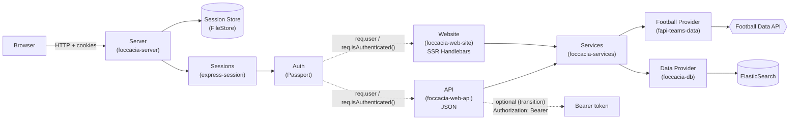
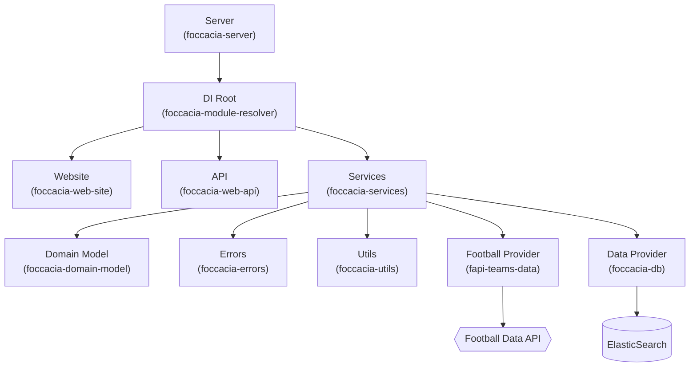

# IPW - Introdução à Programação Web

## Assignment 4
___

- [Practical Assignment](https://github.com/isel-leic-ipw/2526i-IPW-LEIC31D/wiki/IPW_IP-2526-1-A4)


<p align="center">
  
</p>

<h2 align="center">📅 Due date for this assignment: 11/01/2026 — 23h59</h2>

---

## Foccacia

Projeto multi-modulos em Node.js (ESM) - documentação curta para instalação, testes e cobertura.

### Estrutura verificada
- `foccacia-server` (Express entrypoint + configuração)
- `foccacia-module-resolver` (composition root / DI)
- `foccacia-web-api` (API JSON)
- `foccacia-web-site` (SSR Handlebars + forms)
- `foccacia-services` (lógica + validações)
- `foccacia-domain-model` (entidades internas)
- `fapi-teams-data` (Football Data API via fetch + cache)
- `foccacia-db` (ElasticSearch via HTTP fetch)
- `foccacia-data-mem` (standby / compatibilidade)
- `foccacia-errors` (erros tipados)
- `foccacia-utils` (helpers / logging / IO)
- 
### Requisitos
- Node.js >= 18
- npm >= 9
- Docker (para ElasticSearch)
- Ambiente: WSL/Ubuntu recomendado para scripts fornecidos

---

## Configuração

### 1) Football Data API token
Criar o ficheiro:
- `docs/input/headers.json`

Com o conteúdo:
```json
{
  "X-Auth-Token": "COLOCA_AQUI_O_TEU_TOKEN"
}
```

### 2) ElasticSearch (Docker)
Subir:
```sh
npm run docker:up
```

Parar:
```sh
npm run docker:down
```

Limpar volumes:
```sh
npm run docker:down:clean
```

---

## Instalação
```sh
npm install
```

---

## Executar
```sh
npm start
```

- Website: `http://localhost:1904/`
- API: `http://localhost:1904/api/...`

---

## Testes
Executar todos:
```sh
npm run test:all
```

---

## Coverage
Gerar coverage de todos:
```sh
npm run coverage:all
```

---

## GitHub Version Control
___

### **In the Console**

1. **Clone the repository:**
   ```sh
   git clone <repository_link>
   ```

2. **Fetch the latest changes:**
   ```sh
   git fetch
   ```

3. **Before rebasing, remove and save your changes:**
   ```sh
   git stash
   ```

4. **Rebase on the main branch:**
   ```sh
   git rebase origin/main
   ```

5. **After rebasing, retrieve your saved changes:**
   ```sh
   git stash pop
   ```

6. **Create and switch to a new branch:**
   ```sh
   git checkout -b "branch-name"
   ```

7. **Add changes locally:**
   ```sh
   git add <file_path>
   ```

8. **Commit changes locally:**
   ```sh
   git commit -m "message about the changes"
   ```

9. **Push changes to the remote repository:**
   ```sh
   git push
   ```

### **On the Remote Repository (GitHub)**

1. **Go to GitHub and navigate to your repository.**
2. **Switch to your branch.**
3. **Open a Pull Request (PR) and request a review.**

___

## Arquitetura

1. Request flow



2. Dependency wiring (DI)



---

# TODO (P3)

## Auth real (Passport + sessão)
- [ ] Implementar sessões (express-session + FileStore) no `foccacia-server`.
- [ ] Inicializar Passport corretamente (initialize + session).
- [ ] `serializeUser`: guardar `userId`.
- [ ] `deserializeUser`: carregar user pelo `userId` (via services) e expor subset seguro em `req.user`.

## Users (Elastic + services)
- [ ] Guardar credenciais no utilizador (hash + salt) no Elastic.
- [ ] Garantir `username` único.
- [ ] Data provider (`foccacia-db`):
    - [ ] `getUserByUsername(username)`
    - [ ] `getUserById(id)`
- [ ] Services:
    - [ ] `registerUser({ username, password })`
    - [ ] `validateCredentials({ username, password })`
    - [ ] `getUserSafeById(id)` (para `deserializeUser`)
- [ ] (Opcional transição) Manter Bearer token na API até remover completamente.

## SSR flows
- [ ] GET/POST `/register` (form)
- [ ] GET/POST `/login` (form)
- [ ] POST `/logout`
- [ ] Proteger `/groups*` com `requireAuth` (redirect -> `/login`).
- [ ] Remover “user global” no SSR (usar sempre `req.user.id`).

## API protegida
- [ ] Todas as rotas `/api/groups*` só com auth:
    - [ ] sessão (cookie) e/ou (opcional) Bearer durante transição
    - [ ] `401` quando não autenticado
- [ ] Garantir owner-only em todas as operações (listar/ver/criar/editar/apagar/add/remove players).

## OpenAPI + .http
- [ ] `groupId` como string (Elastic `_id`).
- [ ] Alinhar status codes (ex.: deletes 204).
- [ ] Documentar autenticação (cookie session + bearer se aplicável).
- [ ] Atualizar `docs/foccacia-api-requests.http` com fluxos de login.

## Testes
- [ ] Remover boilerplate “hello world”.
- [ ] Unit tests do `foccacia-services` com mocks (`db`, `fapiTeams`).
- [ ] (Opcional) integração com supertest (login + cookie + rotas protegidas).

## Standby / compatibilidade
- [ ] `foccacia-data-mem`: alinhar assinaturas e retornos com o contrato do data-elastic.

---

## Wiki/Relatório (para ires já avançando)

### Estrutura da aplicação
- [ ] Descrever módulos (1–2 linhas cada).
- [ ] Colocar o diagrama Mermaid da arquitetura (acima).
- [ ] Explicar fluxos SSR: register/login/logout + groups.

### ElasticSearch (desenho e dados)
- [ ] Índices usados (ex.: `foccacia-users`, `foccacia-groups`).
- [ ] Campos por documento (users e groups).
- [ ] Relação: `group.ownerId -> user.id`.

### Mapping ES ↔ Domain model
- [ ] Explicar como `User` e `Group` são persistidos (campos e conversões).
- [ ] Explicar players em group como “snapshot” (id/nome/equipa/posição/etc).

### Server API + Auth
- [ ] Referir OpenAPI.
- [ ] Explicar como autenticar (cookie session; e Bearer só se mantiveres transição).

### Runbook (< 5 min)
- [ ] Pré-requisitos (Node/Docker).
- [ ] `npm install`
- [ ] `npm run docker:up`
- [ ] criar `docs/input/headers.json`
- [ ] `npm start`
- [ ] `npm run test:all`
- [ ] (TODO) seed automático de dados de teste

---

## Divisão de tarefas

### Perfis

- **Dev Dinis Correia – Erros e robustez**  
  Foco em error handling, códigos HTTP, mensagens claras.

- **Dev Francisco Mendes – Refactor e modularização**  
  Foco em simplificar funções, extrair helpers, bons nomes.

- **Dev Tiago Nevoa – Arquitetura**  
  Foco em organização de módulos, dependências e alinhamento com o enunciado.

---

### Fase 1 – Arquitetura e dependências (Tiago Névoa)

---

### Fase 2 – Erros e autenticação (Dinis Correia)

---

### Fase 3 – Refactor e regras de negócio (Francisco Mendes)

---

### Fase 4 – Integração final e documentação

1. Dev Tiago Névoa:
    - 
    - 
2. Dev Dinis Correia:
    - 
    - 
3. Dev Francisco Mendes:
    - 
    -
