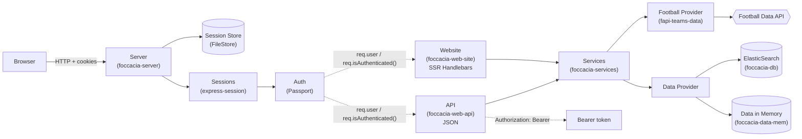
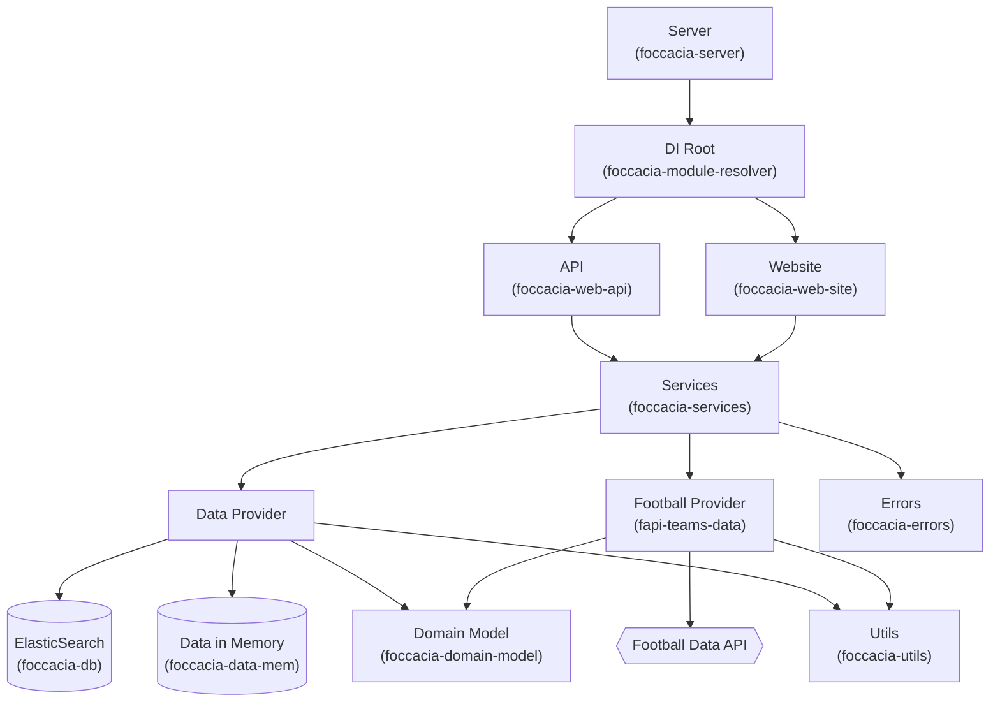

# Estrutura da Aplicação

Uma aplicação modular Node.js para gestão de dados de futebol com interfaces duplas (API + Website).

## Módulos Principais da Aplicação

### `foccacia-server` (Ponto de Entrada)

Servidor Express principal que comanda toda a aplicação. Configura middlewares, autenticação (Passport com sessões) e
motor de views (Handlebars).

### `foccacia-module-resolver` (Injeção de Dependências)

Módulo central que inicializa e conecta todas as dependências. Cria instâncias do modelo de domínio, camadas de dados,
serviços e routers, o que garante a injeção correta de dependências na aplicação.

### `foccacia-services` (Lógica de Negócio)

Camada central de lógica de negócio contendo regras de validação, verificações de autorização e orquestração. Lida com
operações de gestão de utilizadores, operações de grupos e integra chamadas de API externas com persistência de dados.
É no neste módulo onde é feita a esmagadora maioria do tratamento de erros.

## Módulos de Camada de Dados

### `fapi-teams-data` (Integração com API Externa)

Processa comunicação com a Football Data API (https://api.football-data.org). Gere caching, limites de taxa e transforma
respostas da API externa em modelos de domínio.

### `foccacia-db` (Persistência - ElasticSearch)

Camada de dados que utiliza ElasticSearch para armazenar dados persistentemente. Processa operações CRUD (Create, Read,
Update, Delete) para utilizadores e
grupos com indexação, pesquisa e gestão de documentos.

### `foccacia-data-mem` (Armazenamento em Memória)

Implementação de armazenamento de dados volátil em memória para desenvolvimento/testes. Fornece a mesma interface que a
camada persistente mas armazena dados apenas em memória durante a execução.

---

## Módulos de Camada de Apresentação

### `foccacia-web-api` (REST API)

Router Express que expõe endpoints RESTful para clientes externos. Processa autenticação via tokens Bearer,
transformação de requests/responses (DTOs) e delega para serviços.

### `foccacia-web-site` (Website Renderizado no Servidor)

Router Express para páginas web renderizadas no servidor usando templates Handlebars. Gere sessões de utilizador,
submissões de formulários e fornece interface web para gerir grupos e jogadores.

### `views/` (Templates)

Templates Handlebars (.hbs) para renderização no servidor. Inclui o template principal e layouts específicos de páginas
para a interface web.

---

## Módulos de Suporte e Utilidades

### `foccacia-utils` (Utilitários Partilhados)

Coleção de funções utilitárias incluindo logging (info, sucesso, erro), operações de ficheiros I/O, processamento JSON,
resolução de caminhos e helpers de conversão/validação de tipos.

### `foccacia-errors` (Gestão de Erros)

Definições centralizadas de erros e mapeamento de códigos. Fornece objetos de erro consistentes que podem ser traduzidos
para códigos de estado HTTP e mensagens apropriadas.

### `foccacia-domain-model` (Modelo de Domínio)

Define as entidades de negócio centrais (Competition, Team, Player, User, Group) como construtores. Fornece o plano
estrutural para todos os objetos de dados usados em toda a aplicação.

---

## Princípios Arquiteturais

### Autenticação Dupla

- **Baseada em Sessão**: Para utilizadores do website (Passport + express-session)
- **Baseada em Token**: Para clientes da API (tokens Bearer)

### Flexibilidade de Armazenamento

- **Memória**: Armazenamento rápido e volátil para testes (`foccacia-data-mem`)
- **ElasticSearch**: Armazenamento persistente e pesquisável para produção (`foccacia-db`)

### Separação Clara de Responsabilidades

1. **Camada de Apresentação**: `web-api`, `web-site`, `views`
2. **Camada de Negócio**: `services`
3. **Camada de Dados**: `db`, `data-mem`, `fapi-teams-data`
4. **Infraestrutura**: `utils`, `errors`, `domain-model`

### Fluxo de Dados

## Request flow



## Dependency Injection (DI)



# Estrutura de Armazenamento em ElasticSearch

## Índices e Documentos

O módulo `foccacia-db` utiliza dois índices no ElasticSearch:

### Índice `foccacia-users`

Armazena documentos de utilizadores com as seguintes propriedades:

- `username` (keyword) - Nome de utilizador único
- `password` (text) - Senha (pode ser nula)
- `token` (keyword) - Token de autenticação UUID

### Índice `foccacia-groups`

Armazena documentos de grupos com as seguintes propriedades:

- `ownerId` (keyword) - ID do dono do grupo
- `name` (text) - Nome do grupo
- `description` (text) - Descrição do grupo
- `competition` (keyword) - Código da competição
- `year` (integer) - Ano/temporada
- `players` (nested array) - Lista de jogadores

## Relações entre Documentos

**Relação 1:N (Utilizador → Grupos)**

- Um utilizador pode ser dono de múltiplos grupos
- O campo `ownerId` em `foccacia-groups` referencia o `_id` do utilizador
- Não há chaves estrangeiras explícitas, apenas referências lógicas

**Relação de Composição (Grupo → Jogadores)**

- Os jogadores são armazenados como nested objects dentro do documento do grupo
- Não existem como documentos independentes
- A relação é de composição (o jogador existe apenas no contexto do grupo)

## Mapeamento para Modelo de Domínio

### ElasticSearch → Domínio

A conversão inversa é feita pelas funções `mapHitToUser` e `mapHitToGroup` no módulo `foccacia-data-elasticsearch.mjs`,
que reconstroem os objetos de domínio a partir dos documentos do ElasticSearch.

## Características de Design

1. **IDs Únicos**: Os documentos de User e Group usam IDs gerados pelo ElasticSearch como chave primária

2. **Busca Otimizada**: Campos como `token`, `ownerId` e `username` são do tipo `keyword` para permitir buscas exatas e
   rápidas

3. **Nested Objects**: Jogadores são armazenados como nested objects para preservar a relação de pertença ao grupo e
   evitar documentos orfãos

4. **Referências Lógicas**: A relação entre User e Group é mantida através do campo `ownerId`, sem constraints de
   integridade referencial

## Alternativa: Memória vs ElasticSearch

No `foccacia-module-resolver.mjs`, a escolha é configurável:

```javascript
// Para usar memória:
const services = initServices({
    data: dataMem,  // foccacia-data-mem
    // etc...
});

// Para usar ElasticSearch (atual):
const services = initServices({
    data: dataElasticSearch,  // foccacia-db
    // etc...
});
```

# Documentação da API

Nós documentamos a nossa api recorrendo à específicação OpenAPI 3.0.1, a qual pode ser visualizada no diretamente
ficheiro
[foccacia-api-spec.yaml](foccacia-api-spec.yaml), ou de forma interativa e visual por um browser pelo
ficheiro [foccacia-api-spec.html](foccacia-api-spec.html) (gerado
com [openapi-generate-html](https://github.com/qazsato/openapi-generate-html?tab=readme-ov-file)).

# Execução e Testes

## Requisitos

- Node.js >= 18
- npm >= 9
- Docker (para ElasticSearch)
- Ambiente: WSL/Ubuntu recomendado para scripts fornecidos

## Configuração

### 1) Football Data API token

Criar o ficheiro:

- `docs/input/headers.json`

Com o conteúdo:

```json
{
  "X-Auth-Token": "COLOCA_AQUI_O_TEU_TOKEN"
}
```

### 2) ElasticSearch (Docker)

Criar/ligar o container docker do Elasticsearch:

```sh
npm run docker:up
```

Se quiser pará-lo:

```sh
npm run docker:down
```

se quiser limpar os volumes do Elasticsearch:

```sh
npm run docker:down:clean
```

## Instalação

Instalar as dependências utilizadas pelos diversos módulos:

```sh
npm install
```

## Executar

Para executar a aplicação faça:

```sh
npm start
```

## Utilização

Quando a aplicação estiver a correr, poderá utilizar o [website](http://localhost:1904/), interagir
com a API, com o URI <http://localhost:1904/api/>, e fazer pedidos diretamente ao Elasticsearch pelo
URL <http://localhost:9200/>.

## Testes

Executar todos:

```sh
npm run test:all
```

## Coverage
Gerar coverage de todos:
```sh
npm run coverage:all
```

## Popular  a base de dados

Com a aplicação a correr, faça:

```sh
npm run populate
```

## Testes manuais com os ficheiros .http

Pode experimentar fazer pedidos à nossa API através do ficheiro [foccacia-api-requests.http](foccacia-api-requests.http)
Ou à football-data através do ficheiro [football-api-requests.http](football-api-requests.http)

Para utilizar estes ficheiros, precisa ou da
extensão [REST Client](https://marketplace.visualstudio.com/items?itemName=humao.rest-client) para o VSCode
ou da extensão [HTTP Client](https://plugins.jetbrains.com/plugin/13121-http-client) para as IDEs da Jetbrains.
